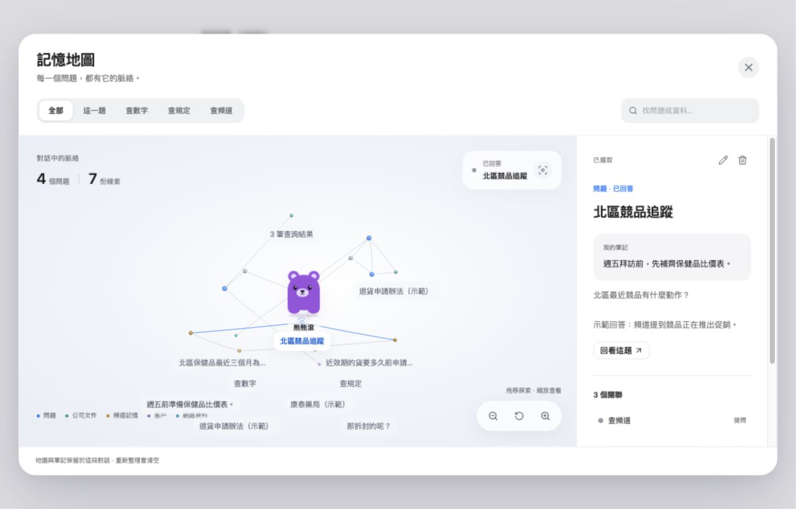
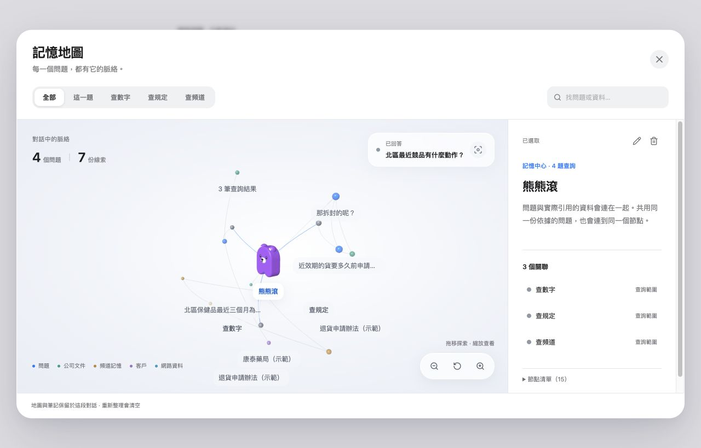
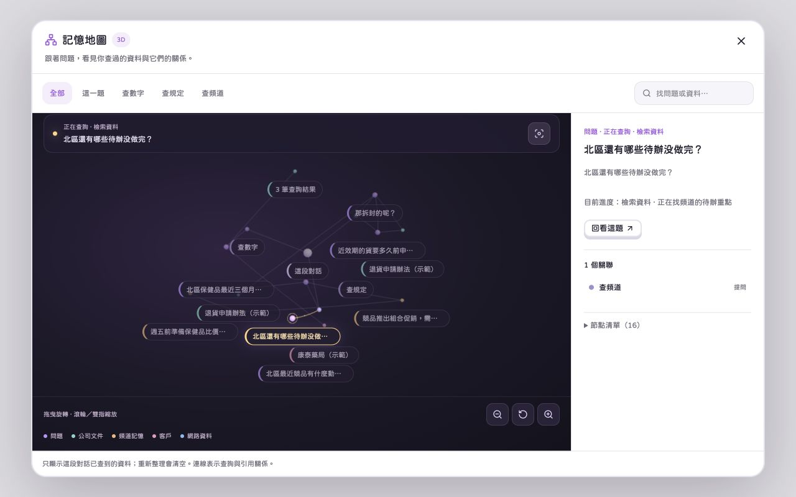

# 問答 3D 記憶地圖

問答頁 `/ask` 的「記憶地圖 · 3D」入口，參考去趣 `demo-repository/frontend/app/components/MemoryGraph3D.client.vue` 的獨立視窗、旋轉、縮放與節點查看互動。

地圖使用同一份打字／語音對話 store。所有問題直接連到同一個對話中心，不再建立查詢類型分區；文件、網路資料、頻道重點、附件、查詢結果與客戶依實際關聯排列。相同文件段落或附件共用節點，連線表示對話、引用與來源關係，不另外猜測內容之間的語意關係。

- 中心使用依既有「熊熊滾」輪廓建立的 3D 模型，包含圓角身體厚度、立體耳朵與附著在正面的五官。模型和節點、連線共用 Three.js 場景與旋轉，能查看側面及背面，縮放也一起改變大小。查詢進行中顯示思考表情，查完回到待機；點選中心可查看、編輯或刪除中心節點。
- 查詢進行中以藍色標示問題及連線，顯示最新查詢步驟；答完、失敗或等待選擇類型時同步更新。
- 移除分類切換列，直接探索同一張網絡。搜尋保留相鄰問題／依據與對話中心，搜尋後自動調整視角；聚焦目前查詢只移動視角，保留其他問題。
- 地圖預設使用完整畫布，點選節點或「節點清單」才展開內容。狀態列、畫布、圖例與縮放按鈕各自保留空間，不以重疊定位堆在一起；手機上的內容區可獨立捲動。標籤在節點附近避讓，擁擠時隱藏部分標籤，可旋轉、縮放或從清單查看。
- 點節點看完整問題、進度、回答或依據；「回看這題」關閉視窗並捲回原回答。客戶、網頁出處與可讀的原始附件頻道提供原有導覽入口。
- 節點可編輯名稱與個人筆記，筆記也能搜尋。刪除節點移除地圖上的節點與連線，原查詢與引用資料保留；提供單筆復原及還原全部。對話、改名、筆記與刪除／復原狀態由後端綁定實際登入帳號長期保存；登出只釋放裝置會話，重新登入、重新整理或換裝置後載回。其他帳號無法讀取，刪除帳號才連帶刪除其記憶。
- Three.js 只在開啟地圖後下載；拖曳旋轉、滾輪或雙指縮放，也可用方向鍵、加減鍵和 Home 操作。
- 排列運算由開啟地圖時建立的單一 Web Worker 處理，只複製節點識別碼、種類及連線；快速搜尋合併等待中的任務並忽略舊結果，關閉地圖終止 worker。worker 無法使用時分批計算，每約 4ms 讓出主執行緒，並可取消。
- 排列使用可重用的數值陣列，改名、筆記及查詢進度更新不重算排列或重建模型。標籤只在視角或內容改變時重新定位，集中寫入及量測，避免逐節點觸發版面計算。共用球體幾何；靜止時只在眨眼、查詢動畫或內容改變時重畫，拖曳維持最高 60fps，背景分頁停止動畫排程。
- WebGL 無法使用或 context 遺失時提供節點清單及重試。動態模組下載失敗可重新整理，帳號記憶仍保留。關閉視窗會釋放 renderer、幾何、材質、事件與 animation frame；減少動態設定停用流光與脈動。
- 地圖每頁顯示 24 題，提供「較早的記憶／較新的記憶」翻頁，完整歷史不受 24 題上限限制。重新讀取查詢時由既有問答 API 組裝答案，重新檢查附件權限並簽發網址；處理中的查詢接續輪詢，不重送。
- `GET/PATCH /api/assistant-memory` 使用真正的登入帳號。對話逐筆 upsert、節點逐筆合併，不以整份快照覆蓋其他裝置的新增內容。舊有 AskRecord 也會還原，並避免與新保存的對話重複。裝置的帳號專屬待同步佇列在失敗或離線時保留，連線恢復、重試或同帳號重登後補送，成功後移除；畫面顯示讀取、保存及失敗狀態。正常登出先嘗試送完待存內容，再撤銷 token。

開發預覽：啟動 Vite 後開啟 `/memory-map.html`。此頁明確標示示範資料，不呼叫 AI，不讀取帳號；提供已回答、正在查詢、空白對話與 601 節點壓力測試。開啟地圖後按 F9 可模擬 WebGL context 遺失。

驗證：`src/ask/memory-map.test.ts` 涵蓋單一網絡連通、與查詢類型無關的排列、節點間距、共用引用、查詢狀態、搜尋、實際依據、附件來源限制及 24 題上限。手機 390×844、320×568 檢查空白提示、搜尋、節點內容及 WebGL 降級與重試；桌面檢查完整網絡與節點內容。

Apple 設計參考：[Meet Liquid Glass](https://developer.apple.com/videos/play/wwdc2025/219/)、[Materials](https://developer.apple.com/design/human-interface-guidelines/materials)、[Color](https://developer.apple.com/design/human-interface-guidelines/color)。這是套用其層次與材質原則的原創網站介面：系統字體、霧白內容畫布、低飽和分類色、單一藍色焦點，浮動控制列使用半透明材質，文字內容面板維持清楚的實色背景。支援深色配色、減少透明度、提高對比與減少動態偏好。

新增的 `src/ask/memory-map-edits.test.ts` 與問答 session 測試涵蓋編輯保留原引用、進度更新後保留筆記、刪除與復原、搜尋筆記、對話中心刪除後仍可搜尋，以及帳號間的狀態隔離。

`src/ask/memory-map-layout-runner.test.ts` 涵蓋 worker 重用、等待任務合併、舊結果丟棄、訊息欄位裁減、關閉後不回傳，以及載入／傳送失敗時的可取消分批計算。另實際檢查 Vite 產出的獨立 worker 資產，及手機預覽的 601 節點網絡與連續搜尋。開發機合成測試中，300 節點排列由約 247ms 降到 30ms，600 節點由約 1543ms 降到 134ms；這是純計算測量，實際手機的渲染與網路時間需另計。

3D 角色驗證：實際拖曳切換正面、側面與背面，五官隨模型轉向；直接點選模型可選取中心節點，縮放會同步改變角色大小。模型幾何與材質在關閉或重建地圖時釋放。

